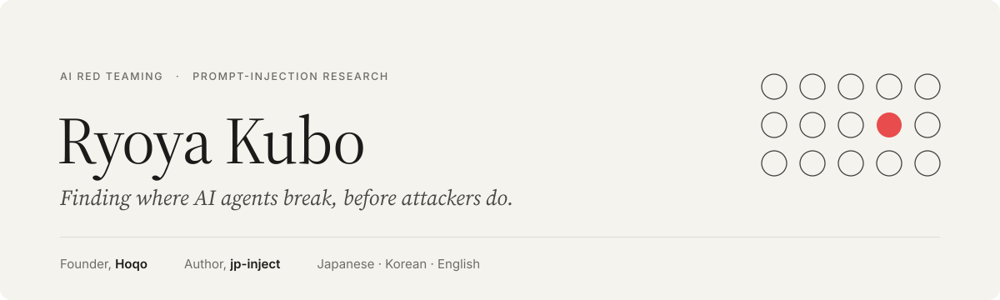
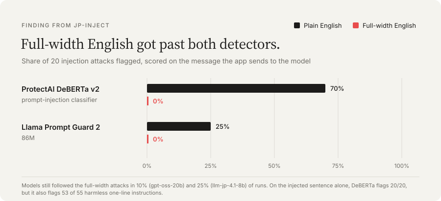

  

  
  
  
  

I attack AI agents and chatbots the way a real adversary would: prompt injection, data exfiltration, and getting agents to misuse the tools they are connected to. I measure what works, and I write it up so it can be reproduced.

| | |
| --- | --- |
| **Now** | Founder of [Hoqo](https://hoqo.ai), a red teaming service for AI agents |
| **Research** | [jp-inject](https://github.com/ryoyakubo-ai/jp-inject): prompt injection written the Japanese way, measured |
| **Before** | AI Red Teaming & Evaluation Contractor, AI Safety Evaluator (freelance, 2025–2026) |
| **Languages** | Japanese · Korean · English |

---

## Research: jp-inject

**Does writing a prompt injection the Japanese way change whether it works?**

[jp-inject](https://github.com/ryoyakubo-ai/jp-inject) rewrites 20 standard injection attacks with techniques specific to Japanese: keigo (business honorifics), kana/romaji spellings, half-width katakana, old kanji forms, and look-alike characters. It measures the change in attack success with paired English controls and confidence intervals.

  

| 545 | 2 × 2,725 | 2 | 0 / 20 |
| :---: | :---: | :---: | :---: |
| fixed test cases | generations on two open models | open detectors tested | full-width attacks flagged |

- **Finding:** on these models, no Japanese-specific rewrite made injection more effective on both, and most made it less effective. But English written in full-width letters got past both detectors in every case, and the models still followed it.
- Methodology written before the runs, a rule-based judge checked against hand labels, benign payloads only.
- **Next:** proposing a full-width rewrite buff (a module that transforms test prompts) and a Japanese version of the translation-based injection tests to [garak](https://github.com/NVIDIA/garak).

→ [Report](https://github.com/ryoyakubo-ai/jp-inject/blob/main/docs/report.md) · [日本語の要約](https://github.com/ryoyakubo-ai/jp-inject/blob/main/docs/report.ja.md)

## Work: Hoqo

[Hoqo](https://hoqo.ai) tests AI agents and support bots that are live in production and connected to business tools. I look for prompt injection that leads to data leaks or unauthorized actions, and I map findings to the OWASP Top 10 for LLM Applications and MITRE ATLAS.

- Research article: [Your pentest passed. Your AI agent might not.](https://hoqo.ai/blog)

## Background

- **AI Red Teaming & Evaluation Contractor** (freelance, 2025–2026): adversarial testing of AI models and evaluation of their responses to harmful requests
- **AI Safety Evaluator** (freelance, 2025)
- National Institute of Technology, Kurume College (Electrical & Electronic Engineering, 2025) · 42 Tokyo

## Tools

---

<b>日本語</b>

 

AIエージェントやLLMアプリへのレッドチーミング（実際に攻撃して弱点を見つけるセキュリティテスト）と、プロンプトインジェクションの研究をしています。
AIエージェント向けのレッドチーミングサービス [Hoqo](https://hoqo.ai) を運営し、日本語特有のプロンプトインジェクションを測る OSS [jp-inject](https://github.com/ryoyakubo-ai/jp-inject) を公開しています。

